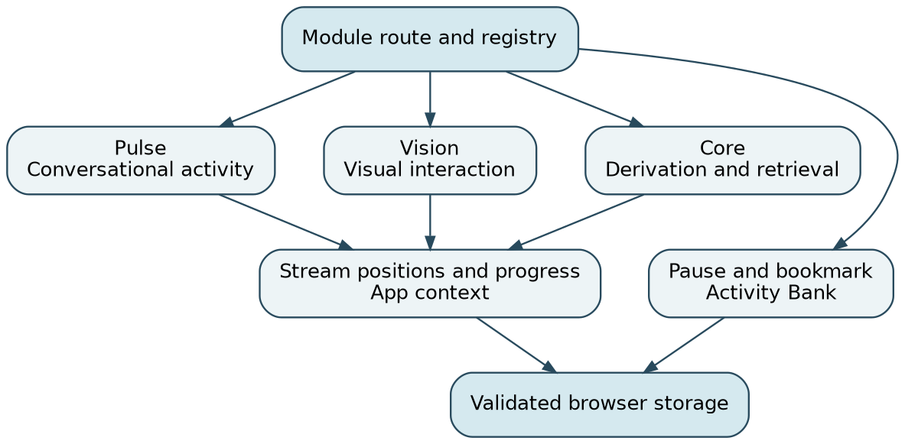

# Learning continuity and offline operation

Module progress, stream positions, and the last stream choice are saved
in the app context. The Activity Bank records pause state, bookmarks, and
sessions. Storage reads pass through validators so malformed persisted
values can fall back to a usable state. These records are local to a browser
origin [@spin-source].

{#fig:learning_continuity width=86% fig-alt="The module route branches to Pulse, Vision, and Core. Progress and pause or bookmark state flow into validated browser storage."}

The production build inserts its bundle inventory into the service worker.
After successful installation, the worker can serve the matching app shell
and lazy chunks offline. The application offers an explicit update action
and retains a previous cache for open tabs that still request older chunks.
